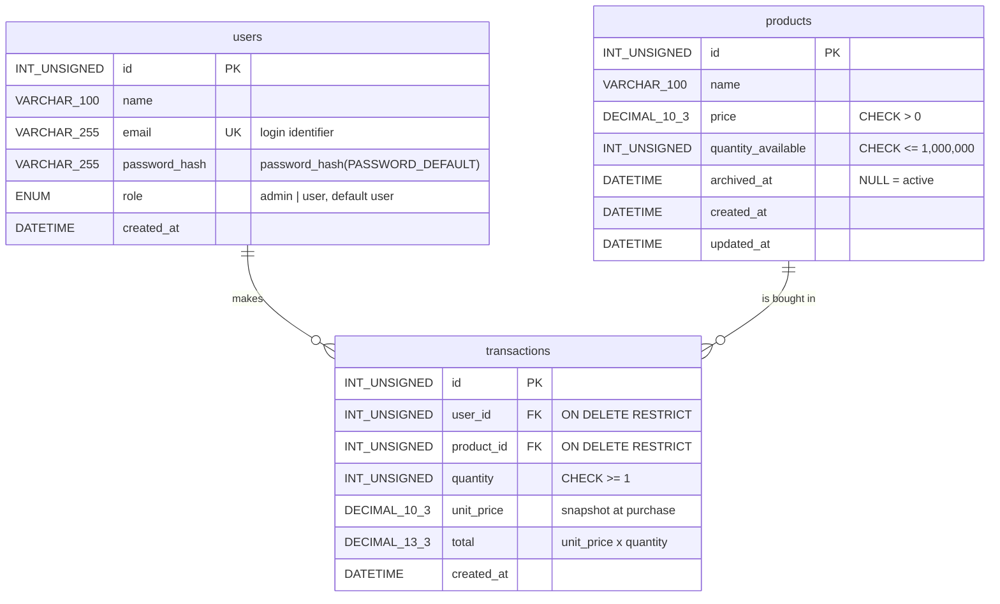

# Vending Machine

A plain-PHP web app and JSON API for a vending machine. Guests browse Products, Users and Admins buy them, and Admins manage the catalogue. Every Purchase is recorded with the Unit Price at that moment.

**Live preview: <https://vending-machine.onrender.com>** (sign in with the [demo accounts](#demo-accounts))

> The preview runs on Render's free tier, which puts the service to sleep after about 15 minutes without traffic. The first request after that takes **about 30 seconds** while it wakes up. After that it responds normally.

The full specification is in [docs/spec.md](docs/spec.md), the vocabulary in [GLOSSARY.md](GLOSSARY.md), and the architectural decisions in [docs/adr/](docs/adr/).

## Overview

| | |
|---|---|
| Language | PHP 8.5 with no framework ([ADR-0001](docs/adr/0001-plain-php-no-framework.md)). The attribute router, DI container, PDO wrapper and view renderer are hand-built in [src/Core/](src/Core/) |
| Dependencies | `firebase/php-jwt`, plus `phpunit/phpunit` for development only |
| Database | MySQL 8 (`utf8mb4`) |
| UI | PHP templates, Pico.css and a little vanilla JS |
| Hosting | A Docker web service on Render, with MySQL on Aiven over TLS ([ADR-0004](docs/adr/0004-render-web-aiven-mysql.md)) |

Money is exact. Prices are `DECIMAL(10,3)` in MySQL, strings in PHP and JSON, and all arithmetic uses `bcmath`, so `6.885 × 2` is always `13.770` ([ADR-0002](docs/adr/0002-exact-three-decimal-prices.md)). A purchase locks the Product row (`SELECT … FOR UPDATE`) inside a transaction. Two buyers therefore can't both take the last one in stock.

## Database design (task 1)

There are three tables: `users`, `products` and `transactions`. Each row in `transactions` is a **Purchase**. The table keeps the name the brief asks for.



The design choices and the reasons for them:

- **Relationships.** A User has many Purchases, and a Product has many Purchases. `transactions` is the join between them and carries its own facts: quantity, Unit Price and time.
- **Products are archived, never deleted** ([ADR-0003](docs/adr/0003-archive-products-and-snapshot-price.md)). "Delete" sets `archived_at`, which hides the Product from every list and lookup. Because rows never disappear, both foreign keys can be `RESTRICT`, and the purchase history always points at a real Product.
- **The price is copied at purchase time.** `unit_price` and `total` are stored on the Purchase, so editing a Product's price later doesn't rewrite history.
- **Exact decimals.** `DECIMAL(10,3)` holds prices such as `6.885`. `total` is `DECIMAL(13,3)`, which is wide enough for the largest price times the largest quantity.
- **The database enforces the rules too.** `CHECK` constraints back up the application's validation: price above 0, Quantity Available no more than 1,000,000, purchase quantity at least 1. `UNIQUE(email)` prevents two Users sharing an email.
- **Indexes.** `transactions(user_id, created_at)` supports a User's history, newest first, and `transactions(product_id)` supports a Product's sales. Together they also serve as the indexes MySQL requires for the two foreign keys.

The schema lives in [database/migrations/](database/migrations/) as numbered SQL files. [bin/migrate](bin/migrate) applies them and records each one in a `migrations` table, so running it again does nothing. The seed adds Coke (3.990), Pepsi (6.885) and Water (0.500) with 10 of each, plus the demo Admin and User.

## Where each task lives

| Task | Code |
|---|---|
| 1 DB design | [database/migrations/](database/migrations/) and [above](#database-design-task-1) |
| 2 PDO + CRUD | [src/Core/Database.php](src/Core/Database.php) and [src/Repositories/](src/Repositories/) |
| 3 Sessions, hashing and roles | [src/Auth/Auth.php](src/Auth/Auth.php), [src/Core/NativeSession.php](src/Core/NativeSession.php) and [src/Controllers/AuthController.php](src/Controllers/AuthController.php) |
| 4 RBAC from the session role | [src/Auth/Guard.php](src/Auth/Guard.php) |
| 5 ProductsController CRUD | [src/Controllers/ProductsController.php](src/Controllers/ProductsController.php) |
| 6 Purchase in the controller | `ProductsController::purchase` and [src/Services/PdoPurchaseService.php](src/Services/PdoPurchaseService.php) |
| 7 Admin-only CRUD views | [templates/products/form.php](templates/products/form.php) and [templates/products/index.php](templates/products/index.php) |
| 8 List with pagination and sorting | `ProductsController::index` and [src/Models/ProductListQuery.php](src/Models/ProductListQuery.php) |
| 9 Purchase view | [templates/products/purchase.php](templates/products/purchase.php) |
| 10 Routing | [src/Core/Router.php](src/Core/Router.php) and [public/index.php](public/index.php) |
| 11 Attribute routing for purchase | `#[Route]` on `ProductsController::purchaseForm` / `purchase`; the attribute is defined in [src/Core/Route.php](src/Core/Route.php) |
| 12 Product validation rules | [src/Validation/ProductValidator.php](src/Validation/ProductValidator.php) |
| 13 Client and server validation | [public/js/app.js](public/js/app.js) together with the server-side validator |
| 14 PHPUnit tests | [tests/Unit/](tests/Unit/), mainly [ProductsControllerTest.php](tests/Unit/Controllers/ProductsControllerTest.php) |
| 15 DI and mocking | [src/Core/Container.php](src/Core/Container.php); the tests mock the repository and service interfaces |
| 16 REST API | [src/Controllers/Api/](src/Controllers/Api/) |
| 17 JWT | [src/Auth/JwtTokens.php](src/Auth/JwtTokens.php) and [src/Api/BearerAuth.php](src/Api/BearerAuth.php) |
| Deploy | [Dockerfile](Dockerfile), [docker/entrypoint.sh](docker/entrypoint.sh), [render.yaml](render.yaml) and [Deployment](#deployment) |

## Local setup

You need Docker. To run the tests you also need PHP 8.5 and Composer on the host. The tests don't use a database.

```sh
cp .env.example .env
docker compose up -d --build   # app on http://localhost:8080, MySQL on 127.0.0.1:3307
composer install && composer test
```

The app container runs the migrations and seed every time it starts.

## Demo accounts

These Users are seeded both locally and on the live site:

| Role  | Email               | Password    |
|-------|---------------------|-------------|
| Admin | `admin@example.com` | `admin1234` |
| User  | `user@example.com`  | `user12345` |

Anyone can also sign up at `/register`, which always creates a User (never an Admin).

## REST API

The base URL is `/api`, and it takes and returns JSON. Protected endpoints need `Authorization: Bearer <token>`.

Tokens are HS256 JWTs. They last one hour and carry the claims `sub` (user id), `role`, `iat` and `exp`. The signing key is the SHA-256 digest of `JWT_SECRET`, because php-jwt requires a 32-byte HS256 key and hashing lets any secret work locally. There are no refresh tokens, so sign in again when a token expires.

| Method | Path | Access | Success |
|---|---|---|---|
| POST | `/api/auth/login` | public | 200 `{token, expires_at, user}` |
| GET | `/api/products?sort=name\|price\|quantity&dir=asc\|desc&page=N` | public | 200 `{data, meta: {page, per_page, total, last_page}}` |
| GET | `/api/products/{id}` | public | 200 `{data}` |
| POST | `/api/products` | Admin | 201 `{data}` + `Location` |
| PUT | `/api/products/{id}` | Admin | 200 `{data}` |
| DELETE | `/api/products/{id}` | Admin | 204 (archives the Product) |
| POST | `/api/products/{id}/purchase` | User or Admin | 201 `{data}` (the Purchase) |

A Product looks like `{"id", "name", "price", "quantity_available"}`. Prices are strings with three decimals (`"6.885"`) so floating point never rounds them. Product bodies take `name`, `price` and `quantity_available`. A purchase body takes `quantity`.

Every error has the same shape:

```json
{"error": {"code": "validation_failed", "message": "The given data was invalid.", "fields": {"price": "Price must be greater than 0."}}}
```

| Status | `code` | When |
|---|---|---|
| 400 | `malformed_json` | The body isn't a JSON object |
| 401 | `unauthenticated` | The token is missing, malformed, tampered with or expired |
| 401 | `invalid_credentials` | Wrong email or password at login |
| 403 | `forbidden` | A User token on an Admin endpoint |
| 404 | `not_found` | No such Product, or it is archived |
| 405 | `method_not_allowed` | The path exists but not for that method (`Allow` lists the methods it accepts) |
| 409 | `sold_out` / `insufficient_stock` | The Product is Sold Out, or more was requested than the Quantity Available |
| 422 | `validation_failed` | Some fields are invalid; `fields` has a message for each one |

### Walkthrough with curl

Pick a target. The examples work the same locally and against the live site. Pulling the token out of the response uses `jq`; without it, copy the `token` value by hand.

```sh
BASE_URL=https://vending-machine.onrender.com   # or http://localhost:8080

login() {  # login <email> <password>: prints a token
  curl -s -X POST "$BASE_URL/api/auth/login" \
    -H 'Content-Type: application/json' \
    -d "{\"email\": \"$1\", \"password\": \"$2\"}" | jq -r .token
}
```

Sign in as the demo User and keep the token:

```sh
TOKEN=$(login user@example.com user12345)
```

The login response looks like this:

```json
{"token": "eyJ0eXAiOiJKV1QiLCJhbGciOiJIUzI1NiJ9…", "expires_at": "2026-11-25T16:01:42+00:00",
 "user": {"id": 2, "name": "Demo User", "email": "user@example.com", "role": "user"}}
```

List Products, cheapest first:

```sh
curl -s "$BASE_URL/api/products?sort=price&dir=asc"
```

```json
{"data": [{"id": 3, "name": "Water", "price": "0.500", "quantity_available": 10}, …],
 "meta": {"page": 1, "per_page": 10, "total": 3, "last_page": 1}}
```

Buy two Pepsis:

```sh
curl -s -X POST "$BASE_URL/api/products/2/purchase" \
  -H "Authorization: Bearer $TOKEN" \
  -H 'Content-Type: application/json' \
  -d '{"quantity": 2}'
```

```json
{"data": {"id": 8, "product_id": 2, "quantity": 2, "unit_price": "6.885", "total": "13.770", "created_at": "2026-11-25T15:01:42+00:00"}}
```

Asking for more than the Quantity Available changes nothing and returns `409 {"error": {"code": "insufficient_stock", "message": "Only 8 available.", …}}`. With the same token, `POST /api/products` returns `403`.

To manage Products, sign in as the Admin:

```sh
ADMIN_TOKEN=$(login admin@example.com admin1234)

curl -s -X POST "$BASE_URL/api/products" \
  -H "Authorization: Bearer $ADMIN_TOKEN" \
  -H 'Content-Type: application/json' \
  -d '{"name": "Iced Tea", "price": "2.750", "quantity_available": 20}'
```

### Postman

Import [docs/postman/vending-machine.postman_collection.json](docs/postman/vending-machine.postman_collection.json) and run it from top to bottom with the Collection Runner. It works like this:

1. It signs in as both demo accounts and saves their tokens.
2. It creates its own Product and buys from it.
3. It triggers every error status.
4. It archives the Product it created, so the seeded data is left alone.

To run it against another deployment, change the `baseUrl` collection variable.

## Deployment

The live site is one Docker web service on Render's free tier. It connects to a free Aiven MySQL over TLS. Render offers only Postgres, so the database lives on Aiven ([ADR-0004](docs/adr/0004-render-web-aiven-mysql.md)).

- The image ([Dockerfile](Dockerfile)) is `php:8.5-apache` with `pdo_mysql` and `bcmath`, and its document root is `public/`.
- On start, [docker/entrypoint.sh](docker/entrypoint.sh) binds Apache to Render's `$PORT` and runs `bin/migrate`, which applies the schema and seed. Then it starts Apache. If the configuration is bad, for example a `JWT_SECRET` that is too short in production, the container exits and the deploy fails.
- [render.yaml](render.yaml) is the Blueprint. It doesn't contain any secrets. Render generates `JWT_SECRET`, and the account owner pastes everything else into the dashboard.
- Render terminates HTTPS and forwards `X-Forwarded-Proto`. In production, session cookies are always marked `Secure`.

### First-time setup (account owner)

1. **Aiven:** create a free MySQL service. From its overview page, copy the host, port, user (`avnadmin`), password and database (`defaultdb`), and download the **CA certificate**.
2. **Render:** go to New → Blueprint and select this repository. Render reads `render.yaml` and asks for each `sync: false` variable:

   | Variable | Value |
   |---|---|
   | `APP_URL` | the service URL, e.g. `https://vending-machine.onrender.com` (not read by the app yet, so any value works if the URL isn't known) |
   | `DB_HOST`, `DB_PORT`, `DB_NAME`, `DB_USER`, `DB_PASSWORD` | from Aiven |
   | `DB_SSL_CA` | `/etc/secrets/ca.pem` |

   Then, in the service's *Environment* tab, add the downloaded certificate as a *Secret File* named `ca.pem`. Render mounts it at `/etc/secrets/ca.pem`.

   `DB_SSL_CA` can instead hold the PEM text itself, but the value must start with `-----BEGIN CERTIFICATE-----` and keep its line breaks. Anything else is treated as a file path, and the deploy fails after about a minute of connection retries.
3. Apply the Blueprint. The first deploy builds the image, migrates and seeds Aiven, and goes live once `/products` passes the health check. Each push to `main` redeploys.

To check that the live site works:

- Open the preview link and confirm it lists Coke, Pepsi and Water.
- Sign in as each demo account and buy something.
- Run the [curl walkthrough](#walkthrough-with-curl) with `BASE_URL` set to the live URL.
